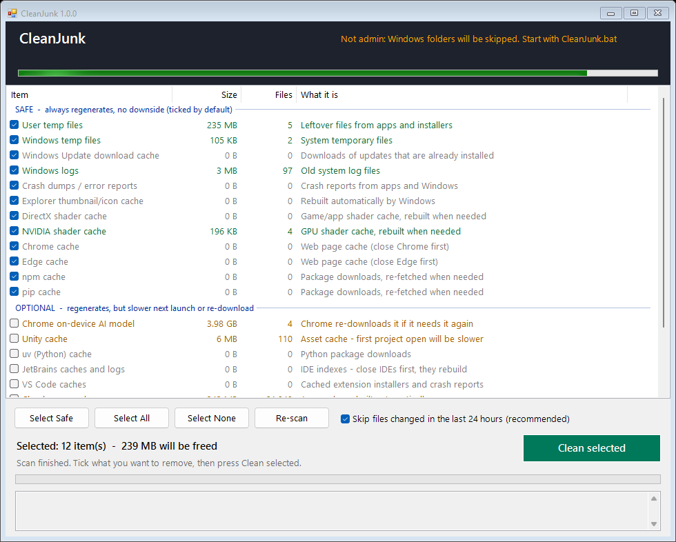

# CleanJunk

A small, open-source Windows tool that finds temp files and caches you don't need, shows you exactly how much space each one uses, and deletes **only what you tick**.

No installer, no background service, no telemetry, no network access. It is one readable PowerShell script plus a launcher.



## Download and run

1. Download `CleanJunk-v1.0.0.zip` from the [Releases](../../releases) page and extract it.
2. Double-click **`CleanJunk.bat`** and click **Yes** at the admin prompt (admin is only needed for the Windows temp/log folders).
3. Wait for the scan, tick what you want to remove, press **Clean selected**, and confirm.

Requires Windows 10 or 11. Nothing else to install (uses the PowerShell that ships with Windows).

> **"Windows protected your PC" / antivirus warning?** The files are not code-signed (signing certificates cost money), and a script that asks for admin and deletes files looks suspicious to heuristics. Before running, you can:
> - read `CleanJunk.ps1` (about 450 lines, no obfuscation, no network calls);
> - verify the download: `Get-FileHash .\CleanJunk-v1.0.0.zip -Algorithm SHA256` must match the `.sha256` file on the release;
> - right-click the zip, **Properties**, tick **Unblock**, then extract.

## What it cleans

**Safe** (ticked by default; always regenerates, no downside)

| Item | Where |
|---|---|
| User temp files | `%TEMP%` |
| Windows temp files | `C:\Windows\Temp` |
| Windows Update download cache | `C:\Windows\SoftwareDistribution\Download` |
| Windows logs | `C:\Windows\Logs` |
| Crash dumps / error reports | `%LOCALAPPDATA%\CrashDumps`, Windows Error Reporting |
| Explorer thumbnail/icon cache | `%LOCALAPPDATA%\Microsoft\Windows\Explorer` |
| DirectX and NVIDIA shader caches | `%LOCALAPPDATA%\D3DSCache`, `NVIDIA\DXCache`, `GLCache` |
| Chrome and Edge cache | `Cache`, `Code Cache`, `GPUCache` of every profile |
| npm and pip cache | `%LOCALAPPDATA%\npm-cache`, `pip\Cache` |

**Optional** (unticked; regenerates, but costs you a re-download or a slower first launch)

Chrome on-device AI model, Unity cache, `uv` cache, JetBrains caches/logs, VS Code caches, Claude app cache, Puppeteer browser downloads, Windows installer package cache (some programs may ask for their installer when you repair them), and the Recycle Bin (**permanent**).

## What it never touches

Downloads, Documents, Desktop, Pictures, Videos, browser logins/history/bookmarks, Docker and WSL disks, game files, app settings, or anything outside the folders listed above. It does not follow junctions or symlinks, so a link inside a cache folder cannot lead it elsewhere.

## Safety features

- **Nothing is deleted until you confirm** a pop-up listing every item and its size.
- **Skips files changed in the last 24 hours** by default (untick the box to turn off), so files that running programs are using right now are left alone.
- Files that are locked or in use are skipped silently; nothing is forced.
- Warns you which of Chrome, Edge, IDEs or Unity are running.
- `-ScanOnly` mode lists sizes and deletes nothing.

## Text mode / command line

```powershell
.\CleanJunk.ps1 -ScanOnly            # list sizes, delete nothing
.\CleanJunk.ps1 -Console             # pick by typing numbers (or use CleanJunk-Text.bat)
.\CleanJunk.ps1 -Console -MinAgeHours 0   # delete files of any age
```

## Disclaimer

Provided **as is, without warranty** (see [LICENSE](LICENSE)). The tool only targets cache and temp locations that programs rebuild on their own, but you use it at your own risk. Anything it deletes does not go to the Recycle Bin.

## Uninstall

Delete the folder. It writes nothing anywhere else.

## License

MIT
